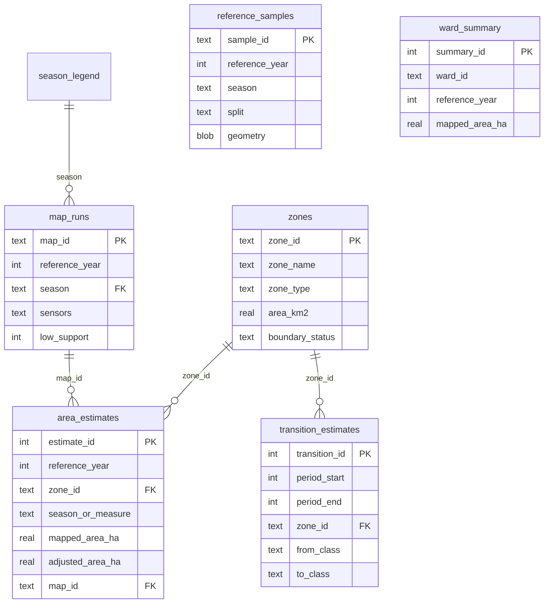

# Database Schema

The study database is created by `skill/rajshahi-rice-landuse/scripts/make_db.py`
from [`rajshahi_rice.sql`](rajshahi_rice.sql).

## Container model

| File | Role | Committed |
| --- | --- | --- |
| `rajshahi_rice.gpkg` | **Canonical.** Spatial layers `zones` and `reference_samples`, plus all attribute tables | No (runtime) |
| `rajshahi_rice.sqlite` | Derived, geometry-free mirror for analytics | No (runtime) |
| `rajshahi_rice.sql` | DDL for attribute tables, lookups, views and seeds | Yes |

A GeoPackage is itself SQLite, so the canonical file serves both needs. The plain
SQLite mirror exists only for tools that cannot open GeoPackage; it is rebuilt by
the same script and must never be edited directly.

Runtime location:

```text
${RAJSHAHI_RICE_DATA_ROOT}/rajshahi-rice/db/rajshahi_rice.gpkg
${RAJSHAHI_RICE_DATA_ROOT}/rajshahi-rice/db/rajshahi_rice.sqlite
```

## Applying

```bash
export RAJSHAHI_RICE_DATA_ROOT=/home/coder/research-runtime/rajshahi-rice
python skill/rajshahi-rice-landuse/scripts/make_db.py --force
```

The script refuses to overwrite an existing database without `--force`, applies
the DDL, registers attribute tables in `gpkg_contents`, runs verification and
writes `manifests/db_manifest.json`.

## Tables

### Protocol tables

| Table | Purpose | Key |
| --- | --- | --- |
| `zones` | Five study zones with geometry | `zone_id` |
| `map_runs` | One row per produced map | `map_id` |
| `reference_samples` | Training, calibration and validation samples | `sample_id` |
| `area_estimates` | Area with accuracy adjustment and intervals | `estimate_id` |
| `transition_estimates` | Five-year class transitions | `transition_id` |
| `ward_summary` | Ward-level summaries | `summary_id` |

### Lookup and support tables

| Table | Purpose |
| --- | --- |
| `season_legend` | Allowed season and derived-product codes |
| `class_legend` | Nine land-cover classes plus no-data (255) |
| `data_sources` | Every source with URL, version, licence and attribution |
| `checksums` | SHA-256 for committed and runtime artifacts |

## Relationships



`ward_summary` is intentionally not tied by a foreign key to a ward table: ward
geometry lives in the GeoPackage `wards` layer inside the boundaries file, and
wards are referenced by `ward_id` plus `boundary_version`.

## Views

| View | Purpose |
| --- | --- |
| `v_area_estimates_full` | Area rows joined to zone names and map-run metadata |
| `v_transition_full` | Transitions joined to zone names |
| `v_map_runs_summary` | Runs per year and season, with low-support counts |

## Enforced rules

- `reference_year` restricted to the eight target years.
- `season` restricted to the six codes in `season_legend` via foreign key.
- `season_or_measure` restricted to seasons, `ALL_UNION` and `INTENSITY_0..3`.
- `sensors` restricted to `landsat` or `landsat+sentinel1+sentinel2`.
- Transition classes restricted to the nine class codes plus `NO_DATA`.
- Areas non-negative; `ua`, `pa` and `f1` in `[0, 1]`.
- Confidence bounds ordered (`ci95_lower_ha <= ci95_upper_ha`).
- `window_end >= window_start`; `period_end > period_start`.
- Foreign keys enforced with `PRAGMA foreign_keys = ON`.

## Verification

`make_db.py` asserts, and records in `manifests/db_manifest.json`:

- all ten expected tables exist;
- `zones` has five rows and `reference_samples` is empty at schema stage;
- no foreign key violations;
- class legend has ten rows and ten data sources are seeded;
- invalid year, invalid season, unknown zone and negative area are all rejected.

## Conventions

- Geometry is stored in EPSG:32645 for analysis layers.
- Dates are ISO 8601 text; timestamps are UTC.
- Areas are hectares to three decimals in tables; zone areas may also be reported in km².
- JSON blobs (`valid_obs_summary`) use compact JSON text.
- A populated database is never committed; only DDL, summaries and manifests are.
